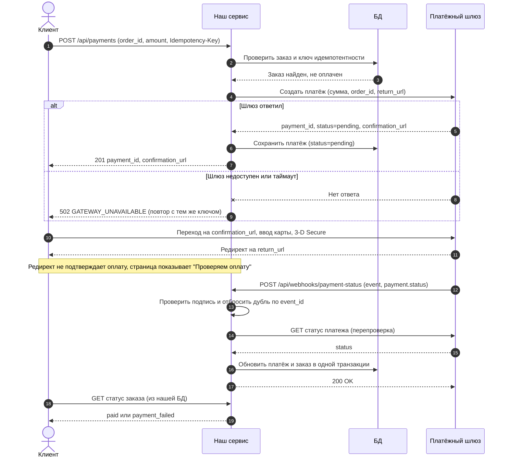
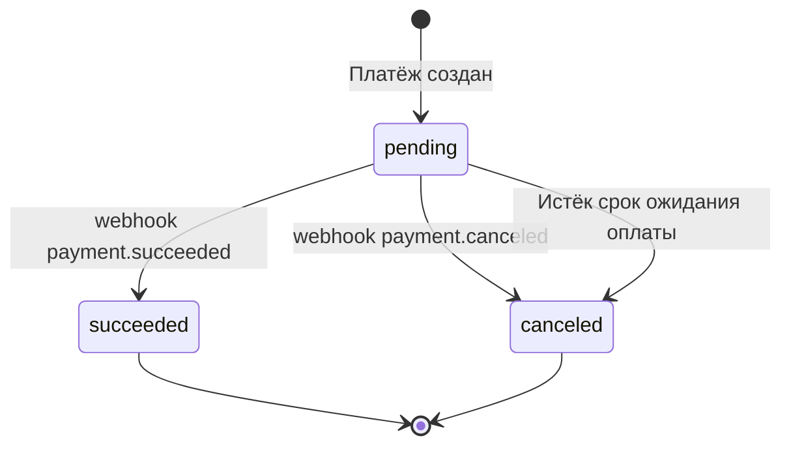
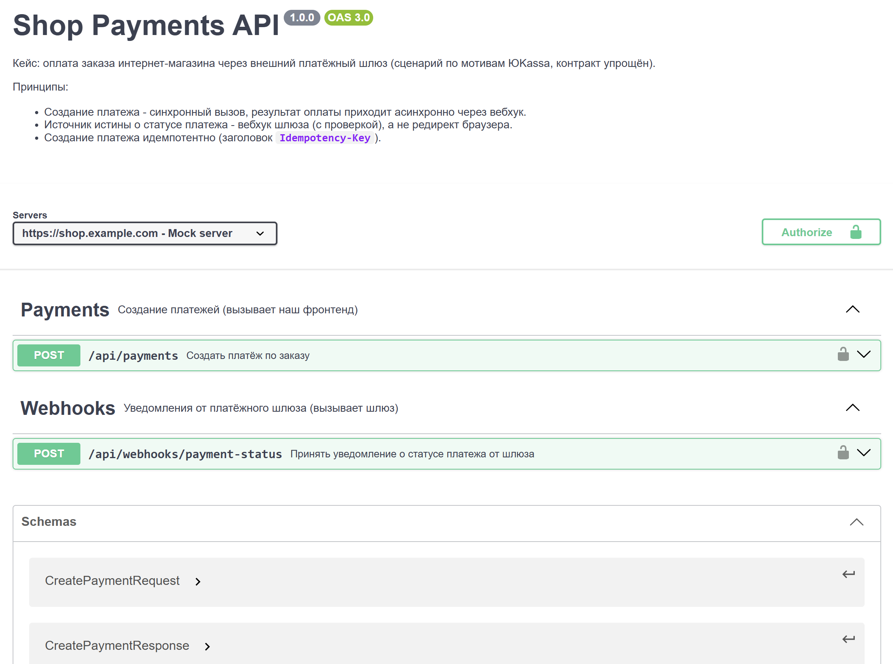

# Кейс 1. Интеграция платёжного шлюза

Проектирование интеграции интернет-магазина с внешним платёжным шлюзом (по мотивам ЮKassa): последовательность взаимодействия, API-контракт и примеры обмена данными.

**Фокус:** REST API, интеграции, асинхронные уведомления (webhook).
**Артефакты:** UML Sequence Diagram, диаграмма состояний платежа, OpenAPI 3.0 ([`openapi.yaml`](./openapi.yaml)), JSON-примеры.

> Уточнение: это проектная документация, а не рабочий код. Контракт упрощён и не копирует API конкретного шлюза.

---

## 1. Контекст и границы

**Задача.** Клиент оформил заказ в интернет-магазине и хочет оплатить его банковской картой. Приём карточных данных и 3-D Secure выполняет внешний шлюз, наш сервис не хранит и не видит данные карты.

**Участники**

| Участник | Роль |
|---|---|
| Клиент (браузер) | Оформляет заказ, переходит на страницу оплаты шлюза |
| Наш сервис (Shop API) | Создаёт платёж, принимает уведомления, меняет статус заказа |
| БД | Хранит заказы, платежи, обработанные события |
| Платёжный шлюз | Принимает оплату, сообщает результат вебхуком |

**В рамках кейса:** создание платежа, приём статуса, обработка ошибок, идемпотентность.
**Вне рамок:** возвраты, холдирование и списание в два этапа, рекуррентные платежи, чеки (54-ФЗ).

---

## 2. Диаграмма последовательности



---

## 3. Жизненный цикл платежа



Конечные статусы не меняются: повторное уведомление с другим статусом для уже завершённого платежа не применяется, а фиксируется в логе для разбора.

---

## 4. API-контракт

| Метод и путь | Кто вызывает | Назначение | Ответы |
|---|---|---|---|
| `POST /api/payments` | Наш фронтенд | Создать платёж, получить ссылку на оплату | 200, 201, 400, 401, 404, 409, 502 |
| `POST /api/webhooks/payment-status` | Платёжный шлюз | Принять итоговый статус платежа | 200, 400, 401 |

Полная спецификация: [`openapi.yaml`](./openapi.yaml). Посмотреть её в удобном виде можно, вставив файл в [Swagger Editor](https://editor.swagger.io/).


**Коды ошибок**

| HTTP | `error.code` | Когда возникает | Что делает клиент |
|---|---|---|---|
| 400 | `VALIDATION_ERROR` | Нет обязательного поля, сумма <= 0, неверная валюта | Исправить запрос |
| 401 | `UNAUTHORIZED` | Нет или недействителен токен | Авторизоваться заново |
| 404 | `ORDER_NOT_FOUND` | Заказа нет | Проверить `order_id` |
| 409 | `ORDER_ALREADY_PAID` | Заказ уже оплачен | Показать статус заказа |
| 409 | `IDEMPOTENCY_KEY_CONFLICT` | Ключ использован с другим телом | Сгенерировать новый ключ |
| 502 | `GATEWAY_UNAVAILABLE` | Шлюз не ответил | Повторить с тем же ключом |
| 401 (вебхук) | `INVALID_SIGNATURE` | Неверная подпись уведомления | Игнорируется, событие не применяется |

---

## 5. JSON-примеры

### 5.1. Создание платежа: успешный сценарий

Запрос:

```http
POST /api/payments
Authorization: Bearer <JWT>
Idempotency-Key: 7b0f6c1e-5a3d-4c8e-9f21-0d4a6e8b1c33
Content-Type: application/json
```

```json
{
  "order_id": "ORD-2026-000123",
  "amount": "2490.00",
  "currency": "RUB",
  "description": "Оплата заказа №ORD-2026-000123",
  "return_url": "https://shop.example.com/orders/ORD-2026-000123"
}
```

Ответ `201 Created`:

```json
{
  "payment_id": "2f6a9c34-000f-5000-8000-1c5b7e2d9a10",
  "order_id": "ORD-2026-000123",
  "status": "pending",
  "amount": "2490.00",
  "currency": "RUB",
  "confirmation_url": "https://pay.gateway.example/checkout?payment=2f6a9c34-000f-5000-8000-1c5b7e2d9a10",
  "created_at": "2026-11-11T10:15:30Z"
}
```

### 5.2. Создание платежа: ошибка валидации

Запрос с отрицательной суммой:

```json
{
  "order_id": "ORD-2026-000123",
  "amount": "-10.00",
  "currency": "RUB",
  "return_url": "https://shop.example.com/orders/ORD-2026-000123"
}
```

Ответ `400 Bad Request`:

```json
{
  "error": {
    "code": "VALIDATION_ERROR",
    "message": "Запрос содержит некорректные данные",
    "details": [
      { "field": "amount", "issue": "Сумма должна быть больше 0" }
    ],
    "trace_id": "9d1c0b7a4e2f4a6b"
  }
}
```

### 5.3. Вебхук: платёж оплачен

```http
POST /api/webhooks/payment-status
X-Signature: <HMAC-SHA256 от тела запроса>
Content-Type: application/json
```

```json
{
  "event_id": "c4e2a8f0-6b1d-4f37-a9c5-2d7e1b0f8a46",
  "event": "payment.succeeded",
  "created_at": "2026-11-11T10:17:02Z",
  "payment": {
    "id": "2f6a9c34-000f-5000-8000-1c5b7e2d9a10",
    "order_id": "ORD-2026-000123",
    "status": "succeeded",
    "amount": "2490.00",
    "currency": "RUB",
    "paid_at": "2026-11-11T10:17:01Z"
  }
}
```

Ответ нашего сервиса `200 OK`:

```json
{ "received": true }
```

### 5.4. Вебхук: платёж отклонён, недостаточно средств

Недостаток средств на карте выясняется уже на стороне банка, после того как платёж создан. Поэтому это не ошибка `400` при создании платежа, а асинхронный результат: платёж переходит в `canceled` с причиной `insufficient_funds`.

```json
{
  "event_id": "91b7d3e5-2a4c-4e86-b0f1-7c3a5d9e2b64",
  "event": "payment.canceled",
  "created_at": "2026-11-11T10:17:02Z",
  "payment": {
    "id": "2f6a9c34-000f-5000-8000-1c5b7e2d9a10",
    "order_id": "ORD-2026-000123",
    "status": "canceled",
    "amount": "2490.00",
    "currency": "RUB",
    "failure_reason": "insufficient_funds"
  }
}
```

Реакция сервиса: платёж получает статус `canceled`, заказ остаётся неоплаченным, клиенту предлагается повторить оплату (новый платёж с новым `Idempotency-Key`).

---

## 6. Ключевые проектные решения

**Идемпотентность создания платежа.** Клиент передаёт `Idempotency-Key`. При сетевом сбое или двойном клике повтор с тем же ключом вернёт уже созданный платёж, а не спишет деньги дважды. Тот же ключ с другим телом запроса даёт `409`.

**Источник истины о статусе оплаты - вебхук.** Редирект клиента на `return_url` можно подделать, закрыть вкладку до него или потерять по сети. Поэтому статус заказа меняется только после уведомления от шлюза, которое мы проверяем.

**Проверка подлинности вебхука.** Эндпоинт публичный, поэтому любой может отправить на него поддельное «оплачено». Защита: проверка подписи `X-Signature` и перепроверка статуса запросом к API шлюза. Конкретный механизм зависит от шлюза (в реальной ЮKassa это, например, список IP-адресов и запрос статуса через API, сверяйтесь с актуальной документацией).

**Дедупликация событий.** Шлюз гарантирует доставку «минимум один раз», поэтому дубли неизбежны. Обработанные `event_id` хранятся в БД, повтор получает `200` без повторного применения.

**Ретраи и быстрый ответ.** Не-2xx ответ шлюз считает сбоем доставки и повторяет отправку. Обработчик отвечает быстро, тяжёлая логика (письма, интеграция со складом) уходит в фон.

**Деньги строкой.** Сумма передаётся как строка `"2490.00"`, чтобы не терять точность на `float`.

---

## 7. Допущения

* Валюта и сумма проверяются на нашей стороне до обращения к шлюзу.
* Один заказ - один активный платёж в статусе `pending`.
* Срок ожидания оплаты ограничен, по его истечении платёж считается `canceled`.
* Статус заказа клиенту отдаёт отдельный эндпоинт нашего сервиса (в кейсе не описан).
